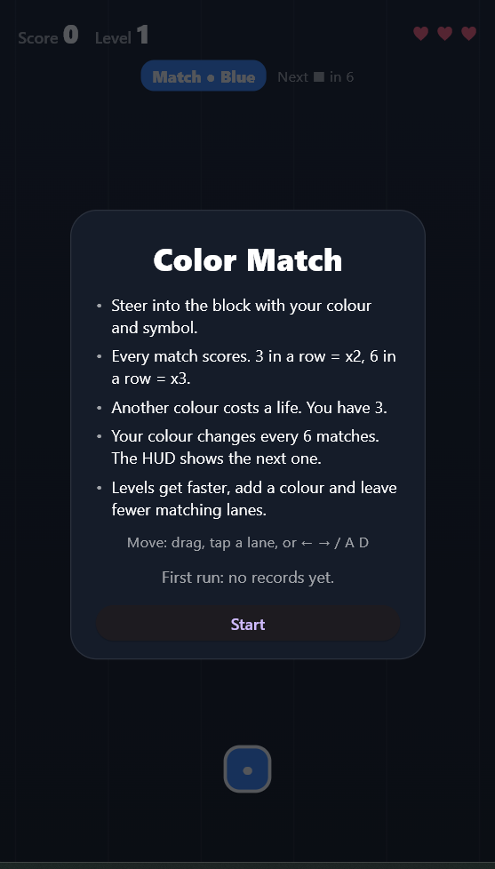
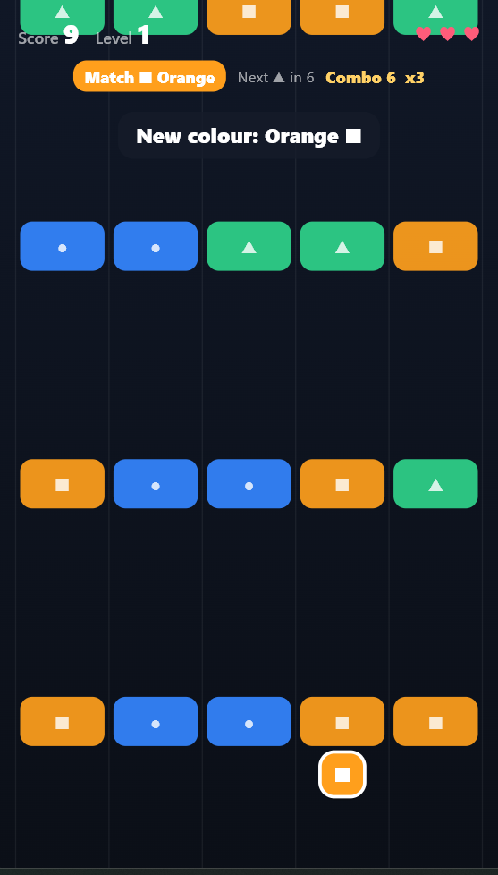
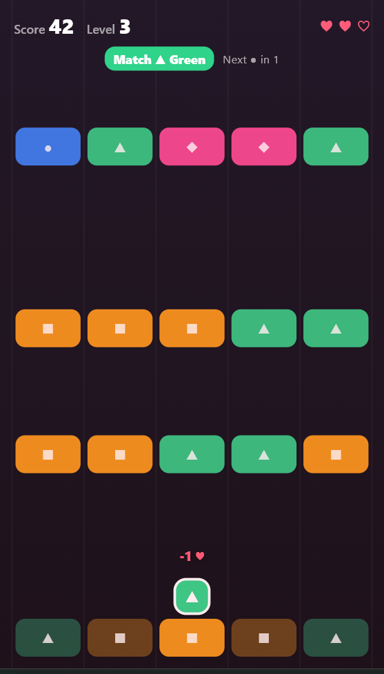
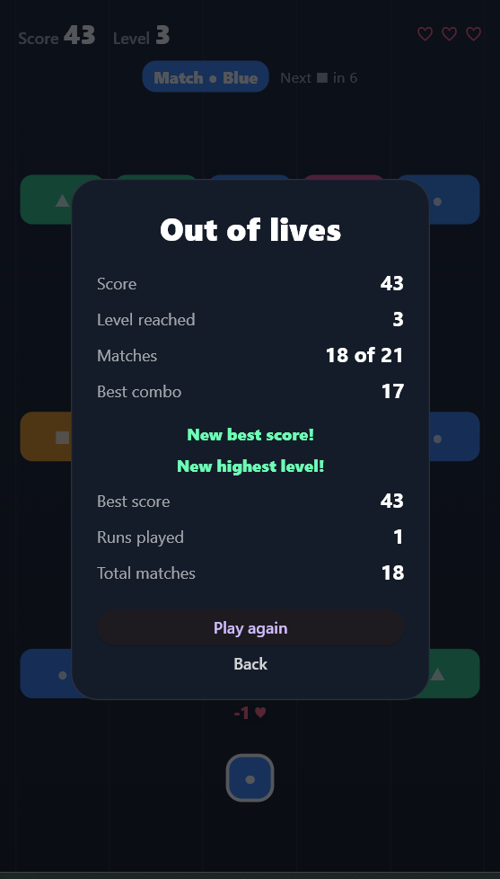
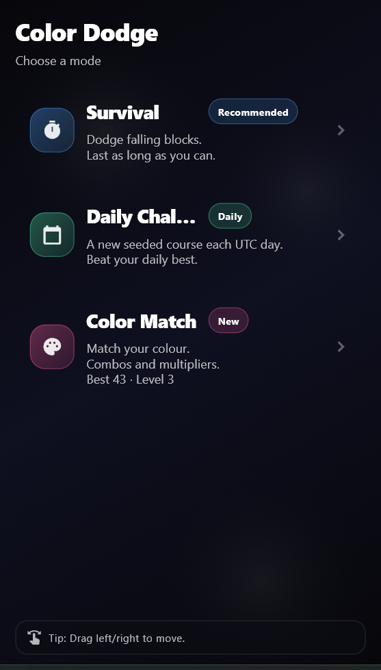

# Color Dodge

A small arcade game built with **Flutter**, **Dart**, and the **Flame** game engine.

Move between five lanes to avoid incoming obstacles. Survive longer to increase your score, watch your near misses, and reach the 150-second finish.

## Current gameplay

- **Survival:** Playable obstacle-dodging mode with a five-lane arena.
- **Daily Challenge:** A UTC-day seeded obstacle run with a separate local record each day.
- **Color Match:** Steer into blocks of your own colour, build combos and survive colour changes and faster levels (see below).
- **Controls:** Drag left or right to move your player. Color Match also accepts a tap on a lane and the arrow keys or A/D.
- **Changing patterns:** Obstacle rows vary as the run progresses.
- **Live HUD:** Displays score during the run, followed by score, best score, and near misses on the results screen.
- **Replay:** Start another run from the end-of-game overlay.

Best scores and Color Match progress are stored locally using SharedPreferences and persist across app launches.

## Color Match



**Rules**

- You are a block with a colour and a symbol (● Blue, ▲ Green, ■ Orange, ◆ Pink). Every row has five coloured blocks.
- Pass through a block of **your** colour to score. Three matches in a row give ×2, six give ×3.
- Any other colour costs one of three lives and resets the combo. The run ends at zero lives.
- Your colour changes every six matches; the HUD always shows the next colour and how many matches are left.
- Every eight matches is a new level: rows fall faster, a fourth colour joins from level 3, and from level 4 only one lane per row matches.
- A matching block is always within two lanes of every matching block in the previous row, so a match is always reachable.

The symbols mean the mode does not depend on telling colours apart.

**Feedback:** "+points" and "-1 ♥" popups at the player, a red flash on a miss, banners for a new colour or level, and a HUD with score, level, lives, current and next colour and combo.

| Colour change and combo | Miss | Results |
| --- | --- | --- |
|  |  |  |

**Local progression:** best score, highest level, best combo, total matches and runs played are stored on the device. The results show what the run changed ("New best score!", "New highest level!"), and the menu card shows the best score and highest level.



The screenshots come from a real Windows desktop run of the app (see *Verified platforms*).

## Technology

| Layer | Technology |
| --- | --- |
| UI and navigation | Flutter / Material |
| Gameplay and rendering | Flame |
| Language | Dart (SDK `^3.10.8`) |
| Static analysis | `flutter analyze` |
| Automated tests | Flutter widget tests |
| Continuous integration | GitHub Actions |

## Run locally

Install the [Flutter SDK](https://docs.flutter.dev/get-started/install), then from the repository root:

```bash
flutter pub get
flutter run
```

Select a connected device or simulator as prompted by Flutter.

## Run quality checks

```bash
flutter analyze
flutter test
```

GitHub Actions runs both commands for pushes to `main` and pull requests. The tests cover the menu (including Color Match progress and returning from a run), best-score storage, collision geometry, the daily seed, the Color Match rules (scoring, combos, lives, colour changes, levels, reachable rows, seeded determinism), Color Match progress storage, and a widget test that plays a seeded Color Match run through the real Flame game loop until the results appear.

### On-device run

```bash
flutter test integration_test/color_match_demo_test.dart -d windows
```

This starts the real app, opens Color Match from the menu, and lets a small bot steer with real key presses until level 3. It then stops steering so the run ends, and checks the results and the updated menu card. Progress is kept in memory, so it does not touch the device's saved data. The integration test is not part of CI (it needs a device).

## Project layout

```text
lib/
  main.dart                 # Flutter app entry point
  game/
    color_dodge_game.dart   # Flame game loop and obstacle patterns
    game_mode.dart          # Mode declarations
    components/             # Visual game components
    color_match/
      color_match_rules.dart  # Color Match rules (pure Dart, unit tested)
      color_match_game.dart   # Color Match Flame game: rows, player, feedback
  storage/
    best_score_store.dart
    color_match_progress_store.dart
  ui/
    mode_select_screen.dart # Game mode selection
    game_screen.dart        # Survival / Daily Challenge view and overlays
    color_match_screen.dart # Color Match rules, HUD and results overlays
    arena_background.dart   # Shared lane background
test/                       # Unit and widget tests
integration_test/           # On-device Color Match run
```

## Current scope and next steps

This is a **portfolio and learning project**, not a published mobile game. All three modes are playable.

### Verified platforms

| Platform | Status |
| --- | --- |
| Windows desktop | Color Match played end to end with the on-device integration test (1 November 2026, Windows 11, Flutter 3.44.6) |
| Unit and widget tests | Run in CI (Ubuntu) and locally |
| Android, iOS, web, macOS, Linux | Not verified for this change |

The Windows window opens in portrait (460 × 820) to match the game's phone layout. Daily Challenge uses the UTC date as the random seed. Device size and game-frame timing may still affect the experience, so this is not a synchronized worldwide leaderboard.

Potential next steps are keyboard controls for Survival, accessibility refinements, and running the on-device test on Android in CI. Keep changes small and covered by automated tests.
